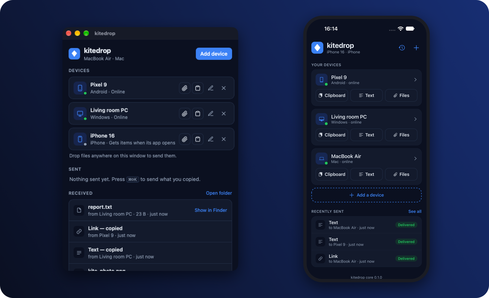

<p align="center">
  
</p>

<h1 align="center">kitedrop</h1>

<p align="center">
  <strong>AirDrop for all of your own devices — iPhone, Android, Windows and Mac.</strong><br>
  <sub>Send files, text and links across your home Wi-Fi in two taps. Devices never vanish from the list, and every send ends as Delivered, Waiting or Failed — never silently lost.<br>End-to-end encrypted with HPKE (RFC 9180), one shared Rust core on every platform. No account, no cloud, nothing leaves your network.</sub>
</p>

<p align="center">
  <a href="https://github.com/mucahitimre/kitedrop/releases"></a>
  <a href="https://github.com/mucahitimre/kitedrop/actions/workflows/ci.yml"></a>
  
  
  <a href="LICENSE"></a>
</p>

<p align="center">
  <a href="SECURITY.md">Security</a> · <a href="CONTRIBUTING.md">Contributing</a> · <a href="docs/release.md">Releasing</a> · <a href="docs/protocol.md">Protocol</a> · <a href="docs/design.md">Design</a>
</p>

<p align="center">
  
  <br><sub>The Mac app and the iPhone app in one group with an Android phone and a Windows PC.</sub>
</p>

---

## The essentials

These three are why kitedrop exists — the parts that LAN-sharing apps tend to get wrong:

<table>
<tr>
<td width="33%" valign="top">

### 📌 Devices never vanish

The list is **your paired devices**, not whatever discovery happens to see this second. A phone with its
screen off stays in the list with a grey dot; it does not disappear and come back.

</td>
<td width="33%" valign="top">

### ✅ Delivered means delivered

*Delivered* appears only after the other device returns a **signed receipt**. Otherwise a send is *Waiting*
(retried by itself until the device is back) or *Failed* with a reason in plain words. Nothing is lost
silently.

</td>
<td width="33%" valign="top">

### 📲 Every direction, two taps

Phone → computer through the share sheet, computer → phone by dropping files or pressing **⌘⇧K /
Ctrl+Shift+K** for the clipboard. Text and links land on the other device's clipboard, files in
`Downloads/kitedrop`.

</td>
</tr>
</table>

And underneath it all: **one Rust core** with one encrypted envelope format, used by the desktop app directly
and by the phone apps through native bindings.

## Why kitedrop

AirDrop only works between Apple devices, and the alternatives have their own gaps:

- ✗ Devices appear and disappear from the list while you are trying to send
- ✗ "Send" sometimes delivers nothing — and does not tell you
- ✗ An iPhone in your pocket is unreachable, so sends to it simply fail
- ✗ Cloud services need an account and route your files through someone else's server
- ✗ Sending a link or a snippet of text is as clumsy as sending a file

## The Solution

**Pair your devices once** by scanning a QR code. From then on every device sees the others, sends go straight
over your Wi-Fi, end-to-end encrypted, and each one ends with a clear result.

| | |
|---|---|
| 📋 **Clipboard in one key** | ⌘⇧K / Ctrl+Shift+K sends what you copied; text and links arrive on the other clipboard |
| 📥 **Share sheet everywhere** | iPhone, Android and macOS share menus, Windows "Send to", drop on the window on Mac and Windows; folders go as a .zip |
| ✅ **Signed receipts** | *Delivered* only with the receiver's signature; *Waiting* retries by itself; *Failed* says why |
| 📦 **Outbox for the iPhone** | Items for an iPhone wait on the sender (up to 7 days) and arrive the next time kitedrop opens there |
| 🔔 **Actionable notifications** | Received file → click shows it in its folder, or Open / Copy / Show in Finder; link → Open / Copy |
| 🔐 **End-to-end encrypted** | HPKE (RFC 9180) envelopes sealed to the receiving device; file names and sizes are encrypted too |
| 🔗 **QR or link pairing** | 60-second, one-use codes; a computer can show the code, or two computers pair with a pasted link |
| 🩺 **Plain-language diagnostics** | Detects a Public Windows network, guest Wi-Fi / client isolation, missing Local Network permission |
| 🧩 **One core, four platforms** | Rust core, Tauri desktop app, Expo app with a native Swift share extension and a Kotlin service |

## Install

Downloads are on the [Releases](https://github.com/mucahitimre/kitedrop/releases) page.

- **macOS:** open the `.dmg`, drag kitedrop to Applications, open it. The app is signed with a Developer ID but
  not notarized yet, so the first open is blocked: go to System Settings → Privacy & Security, choose
  **Open Anyway** next to the kitedrop message, and confirm. Allow **Local Network** when macOS asks
  (System Settings → Privacy & Security → Local Network → kitedrop). kitedrop lives in the menu bar and starts
  at login. If kitedrop is missing from the **Share** menu, choose *Edit Extensions…* at the bottom of that menu
  and turn kitedrop on.
- **Windows:** run `kitedrop-…-windows-x64-setup.exe`. The installer is not code-signed, so SmartScreen shows
  "Windows protected your PC": choose *More info → Run anyway*. It adds a firewall rule for **private**
  networks only and an Explorer "Send to" entry; kitedrop starts at sign-in and lives in the tray.
- **Android:** download the `.apk` on the phone and open it (allow installing from your browser when Android
  asks). Then open kitedrop and allow notifications and "no battery restrictions" so it can receive with the
  screen off.
- **iPhone:** TestFlight, for the author only. To run it on your own iPhone, [build it](#build-from-source)
  with your Apple team.

## Usage

**Pair once.** On a device already in your group open kitedrop → **Add device**: it shows a QR code valid for
60 seconds, one use. On the new device: **Add a device → Scan**.

- A computer without a camera: choose **Join a group** on it and scan its code with a phone.
- Two computers: **Copy link for another computer** on one, paste it on the other and press **Pair**. Send the
  link through something you trust — whoever sees it in that minute could use it.
- Android can also **Show code** for another phone to scan.

**Send:**

| From | How |
|---|---|
| Mac | Share → kitedrop in Finder, Safari and other apps, drop files or folders on the kitedrop window, ⌘⇧K sends the clipboard, the device card's 📎 / 📋 buttons |
| Windows | Explorer → right-click → Send to → kitedrop, drop files or folders on the window, Ctrl+Shift+K sends the clipboard |
| Android | share sheet → kitedrop, or the app's **Clipboard / Text / Files** buttons |
| iPhone | share sheet → kitedrop (several photos or files at once), or the app's **Clipboard / Text / Files** buttons |

**Receive:**

| On | Files | Text and links |
|---|---|---|
| Mac, Windows | `Downloads/kitedrop`; clicking the notification shows the file in its folder, buttons Open / Copy / Show in Finder | clipboard, notification with Copy |
| Android | `Downloads/kitedrop`, notification | clipboard, notification with Copy |
| iPhone | photos and videos → Photos, other files → Files › kitedrop | clipboard |

The iPhone does not listen on the network (iOS does not allow that in the background). It fetches what your
other devices kept for it when you open kitedrop or pull to refresh. For iPhone → Mac, AirDrop still works.

**Remove a device** with the ✕ on its card (desktop) or on its page (phone); it is removed on every device.

## Network troubleshooting

All devices must be on the same network. kitedrop tells you when it sees one of these problems:

| Message | What to do |
|---|---|
| *A Windows PC treats this network as Public* | Windows Settings → Network & internet → Wi-Fi → your network → **Private network**. The firewall rule only opens kitedrop on private networks. |
| *Your devices cannot see each other on this Wi-Fi* | You may be on a guest network, or the router has "client isolation" / "AP isolation" on. Use the main network or turn the isolation off. |
| *kitedrop may not use the local network* (Mac, iPhone) | Settings → Privacy & Security → **Local Network** → turn kitedrop on. |
| *One of your devices was last seen on a different network* | That device is on another Wi-Fi or on mobile data. Sends to it wait until it is back. |
| *This network is very large* | kitedrop only searches the nearby part of networks bigger than /22. Known devices are still found at their last address. |
| *kitedrop could not open a network port* | Another program uses ports 52525–52534. Quit it, or restart. |
| Android shows *offline* with the screen off | Allow kitedrop to run without battery restrictions (Settings → Apps → kitedrop → Battery → Unrestricted). |
| A VPN is on | Many VPNs block local traffic. Turn on "allow LAN access" in the VPN, or turn it off. |

## Architecture

```
core/      Rust: identity, signed group list, pairing, HPKE envelope, HTTP server/client,
           outbox and retry, discovery (last address → mDNS → subnet scan), diagnostics
ffi/       UniFFI bindings of the core for Swift and Kotlin
cli/       `kitedrop daemon`: a headless device for tests and development
desktop/   Tauri v2 tray / menu-bar app for macOS and Windows (uses the core directly)
desktop/macos-share/  macOS share extension (hands items to the app's send window)
mobile/    Expo app (UI) + native code:
             modules/kitedrop-native   Kotlin foreground service, Swift runtime, delivery to Photos / Files
             targets/share             iOS share extension (seals and uploads without the app)
protocol/  machine-readable test vectors; the core tests run against them
```

Every transfer is an envelope sealed to the receiving device's key with HPKE in auth mode (which also proves the
sender), streamed in chunks over plain HTTP on the LAN. Requests are signed; the group membership list is a
signed, versioned chain. Details: [protocol](docs/protocol.md), [design](docs/design.md), the reasons behind each
choice: [decisions](docs/decisions.md), the threat model and trade-offs: [SECURITY.md](SECURITY.md).

## Build from source

```bash
scripts/ci.sh                        # fmt, clippy, all Rust tests (incl. RFC 9180 and protocol vectors)
scripts/build-desktop.sh mac         # .app; set APPLE_SIGNING_IDENTITY for a Developer ID signature
scripts/build-desktop.sh windows     # NSIS installer, cross-built from a Mac
scripts/mobile.sh android            # Rust core + APK, installs on the connected phone
scripts/mobile.sh ios                # Rust core + Release build, installs on the connected iPhone
```

Prerequisites, layout and rules: [CONTRIBUTING.md](CONTRIBUTING.md).

## Known limitations

- Same network only: nothing goes over the internet, and devices must be able to reach each other on the LAN.
- The iPhone receives only when kitedrop is opened there; push notifications to wake it are not set up yet.
- IPv4 only; text and links up to 8 MiB each (files have no such limit).
- The progress bar is shown on the sending device only.
- The Windows installer is not code-signed; the Android APK is arm64 only.
- A sending laptop that goes to sleep with the lid closed delivers its pending items after it wakes up.
- Android has been tested on one Samsung phone so far.

## Roadmap

- [x] Mac, Windows, Android and iPhone in one group, pairing by QR or link
- [x] Notifications with actions on Mac and Windows
- [x] Release pipeline: draft releases with checksums from GitHub Actions
- [ ] Signed and notarized macOS releases from CI (secrets)
- [ ] Push notifications that wake the iPhone (Expo / APNs)
- [ ] TestFlight builds
- [x] macOS share menu (Finder, Safari, …) and folders as .zip
- [x] Progress bar for large sends
- [ ] Mac ↔ Windows clipboard sync, Windows 11 context menu (after v1)

## Releasing

Version tags `vX.Y.Z` build the Windows installer, the universal macOS app and the Android APK into a draft
GitHub release; iPhone builds go through TestFlight. See [docs/release.md](docs/release.md).

## Contributing and license

- Guide: [CONTRIBUTING.md](CONTRIBUTING.md) · Security: [SECURITY.md](SECURITY.md)
- CI (GitHub Actions): Rust checks and tests on Linux and Windows, mobile typecheck and lint on every push and
  pull request.
- License: [MIT](LICENSE) © 2026 Mücahit İmre
